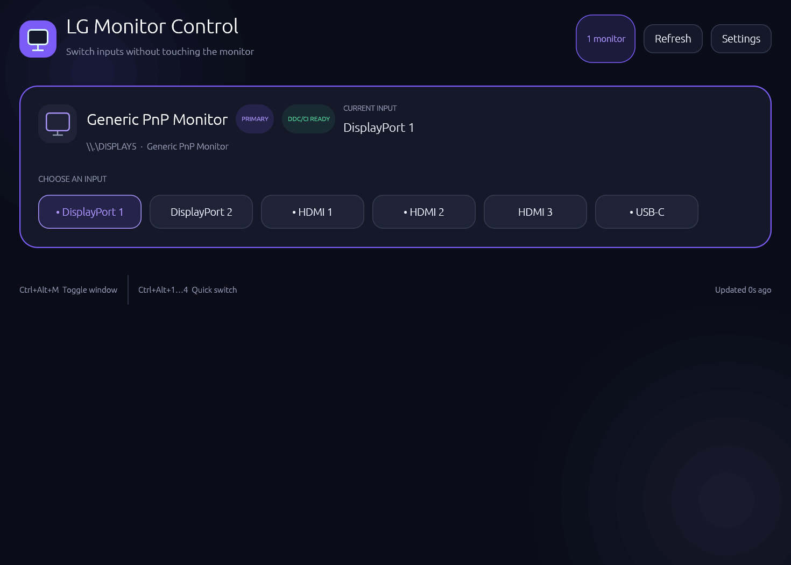

# LG Monitor Control

一款面向 Windows 的原生显示器输入源切换工具。它使用 Rust、`eframe/egui` 和 Windows Monitor Configuration API 构建，支持从桌面界面、系统托盘或全局快捷键快速切换输入源。



## 功能

- 自动发现 Windows 中的物理显示器
- 读取当前输入源（VCP `0x60`）
- 从显示器 capabilities string 自动解析型号和可用输入值
- 多显示器卡片和主显示器设置
- 输入源别名、收藏项和自定义 VCP 值
- `Violet`、`Cyan`、`Rose` 三种强调色
- 紧凑卡片模式
- 系统托盘、关闭到托盘和单实例保护
- 全局快捷键
- DDC/CI 操作在专用后台线程执行，不阻塞界面
- 写入后回读、重试和结果验证，避免把“API 返回成功但显示器忽略命令”误报为成功
- 针对 LG WK95U/BK95U 的 USB HID / Intel IGCL 私有通道回退
- 配置只保存在本机，不需要网络服务或账号

## 快捷键

| 快捷键 | 功能 |
| --- | --- |
| `Ctrl+Alt+M` | 显示或隐藏窗口 |
| `Ctrl+Alt+1` | 切换主显示器的第 1 个可用输入 |
| `Ctrl+Alt+2` | 切换主显示器的第 2 个可用输入 |
| `Ctrl+Alt+3` | 切换主显示器的第 3 个可用输入 |
| `Ctrl+Alt+4` | 切换主显示器的第 4 个可用输入 |
| `R` | 刷新显示器 |
| `S` | 打开或关闭设置面板 |
| `Esc` | 关闭设置面板 |

数字快捷键按显示器实际声明的输入列表工作，不再假设第 4 个输入一定是标准 USB-C `0x1B`。

## 运行要求

- Windows 10 或 Windows 11
- 支持 DDC/CI 的显示器
- 已在显示器 OSD 菜单中启用 DDC/CI
- 建议使用显示器与显卡之间的直连线缆
- 使用 LG USB 私有通道时，需要把显示器的 USB upstream 接到当前电脑

以下设备可能阻断或改写 DDC/CI：

- 部分 USB-C Dock
- KVM
- HDMI/DisplayPort 转换器
- MST Hub
- 部分显卡驱动或虚拟显示设备

如果切换后画面闪黑并自动回到原输入，请在显示器 OSD 中关闭 `Auto Input` 或 `Auto Input Switch`。

## 输入源检测

应用首先读取显示器返回的 capabilities string，并解析 VCP `0x60` 的可选值。例如 LG WK95U 返回：

```text
model(WK95U)
60(11 12 0F 10)
```

结合 WK95U 的实际端口，界面会显示：

| VCP 值 | 输入 |
| --- | --- |
| `0x11` | HDMI 1 |
| `0x12` | HDMI 2 |
| `0x0F` | DisplayPort 1 |
| `0x10` | Thunderbolt / USB-C |

因此，WK95U 不会再错误显示或发送该型号没有声明支持的通用 USB-C 值 `0x1B`。

## LG 特殊输入切换

一些 LG 显示器会在 capabilities 中声明标准输入源 VCP `0x60`，但实际写入时只闪屏而不切换。GitHub 上的 [ddcutil 讨论](https://github.com/rockowitz/ddcutil/issues/100) 和 [LG 输入切换说明](https://github.com/rockowitz/ddcutil/wiki/Switching-input-source-on-LG-monitors) 记录了 LG 的私有 DDC2AB 通道：

- DDC/CI source address：`0x50`，而不是标准的 `0x51`
- VCP code：`0xF4`
- 常见值：
  - HDMI 1：`0x90`
  - HDMI 2：`0x91`
  - DisplayPort：`0xD0`
  - 第二个 DisplayPort 或 USB-C：通常为 `0xD1` 或 `0xD2`，具体取决于型号和固件

Windows 的 `SetVCPFeature` 无法指定 source address，因此不能直接访问这个私有通道。

### 当前实现

对于 capabilities 型号为 `WK95U` 或 `BK95U` 的显示器：

1. 先通过标准 VCP `0x60` 写入。
2. 等待显示器完成切换并回读验证。
3. 如果显示器连续返回旧输入，应用会尝试 LG 私有通道。
4. 如果检测到 LG USB 控制设备 `043E:9A39`，应用会先尝试通过 USB HID bridge 发送 `0x50/0xF4` 命令。
5. 否则，当显示器挂在 Intel 显卡上时，应用通过 Intel Graphics Control Library 的 `ctlI2CAccess` 发送同一条 `0x50/0xF4` 命令。
6. Intel 私有写入需要管理员权限；只有触发该回退时才显示 UAC，不要求整个应用始终以管理员身份运行。
7. Intel 命令会发送两次，中间等待 1.2 秒，以兼容需要先唤醒 DDC 通道的 LG 固件。

WK95U/BK95U 当前使用以下私有映射：

| 标准输入 | LG 私有值 |
| --- | --- |
| DisplayPort `0x0F` | `0xD0` |
| Thunderbolt / USB-C `0x10` | `0xD2` |
| HDMI 1 `0x11` | `0x90` |
| HDMI 2 `0x12` | `0x91` |

私有通道是 write-only，无法像标准 VCP 一样回读确认。应用会明确显示“已发送 LG alternate command”，而不会伪造已验证成功的当前输入状态。

Intel IGCL 原始 I²C 路径向 DDC 写地址 `0x6E` 发送完整 DDC/CI SetVCP 帧，`Offset` 保持 `0`：

```text
50 84 03 F4 00 <private-input> <xor-checksum>
```

其中 checksum 对 `6E 50 84 03 F4 00 <private-input>` 做 XOR。LG USB HID bridge 使用同一条 SetVCP 语义，但 bridge payload 的 length byte 不带 DDC/CI control flag：

```text
50 04 03 F4 00 <private-input> <xor-checksum>
```

如果 USB bridge 只返回空 I²C payload，应用会继续尝试 Intel IGCL，而不会把“写入 HID report 成功”误报为输入已切换。

本项目对 WK95U 的实测结论记录在 [LG WK95U Input Switching Notes](docs/lg-wk95u-protocol.md)。

Intel 回退要求 Intel 驱动提供：

```text
C:\Windows\System32\ControlLib.dll
```

如果同一 Intel 显卡上连接了多个外接显示器，应用不会猜测目标并误切其他显示器；在能可靠建立显示器映射之前，它会返回明确错误。

NVIDIA NVAPI 和 AMD ADL 私有通道后端尚未集成。标准 VCP `0x60` 路径不受此限制。

## 切换结果

应用区分三种结果：

- **Verified**：写入后回读值与目标输入一致。
- **Command accepted**：显示器在写入后停止响应；这通常发生在成功切到另一个输入后，当前 DDC 链路随之消失。
- **LG alternate command sent**：已通过 write-only 的 LG 私有通道发送命令，无法回读验证。

如果显示器持续返回旧值，应用会报告错误，而不是显示虚假的成功提示。

## 配置文件

默认配置路径：

```text
%APPDATA%\tkpdx01\LG Monitor Control\config\settings.json
```

配置包括：

- 主显示器
- 显示器别名
- 输入源名称和自定义值
- 收藏输入
- 强调色
- 紧凑模式
- 关闭到托盘
- 全局快捷键开关

## 从源码构建

需要最新稳定版 Rust toolchain：

```powershell
cargo build --release
```

可执行文件位于：

```text
target\release\lg-monitor-control.exe
```

开发检查：

```powershell
cargo fmt --all -- --check
cargo test
cargo clippy --all-targets --all-features -- -D warnings
```

## 当前限制

- 目前只支持 Windows。
- 输入源值由显示器固件决定；不同 LG 型号可能使用不同私有值。
- capabilities string 可能不完整甚至不准确，因此应用允许添加自定义输入值。
- 切到另一台电脑后，原电脑可能不再能访问显示器的 DDC 通道；要从另一台电脑切回来，需要在那台电脑上运行兼容工具。
- LG 私有通道可能只接受来自当前活动输入的命令。
- WK95U/BK95U 通过 LG 私有通道切换后，标准 `VCP 0x60` 读数可能继续报告旧输入；应用会把该读数标记为 reported，而不会用它拦截后续切换。
- Dock、KVM 或转换器可能让输入读取成功但写入失败。
- 当前 release 提供免安装 zip 包，不包含代码签名安装程序。

## 技术栈

- Rust 2024 edition
- `eframe` / `egui`
- Windows Monitor Configuration API
- Intel Graphics Control Library（LG 私有通道回退）
- `tray-icon`
- `global-hotkey`
- `serde` / `serde_json`
- `crossbeam-channel`

## 参考资料

- [ddcutil: Switching input source on LG monitors](https://github.com/rockowitz/ddcutil/wiki/Switching-input-source-on-LG-monitors)
- [ddcutil issue #100](https://github.com/rockowitz/ddcutil/issues/100)
- [Windows + Intel IGCL LG input switch](https://github.com/Jason7536/lg-input-switch)
- [LG USB HID control reverse engineering](https://github.com/shinyquagsire23/lg_display_manager)
- [Windows + NVIDIA NVAPI raw I²C example](https://github.com/kaleb422/NVapi-write-value-to-monitor)
- [LG 34WK95U-W ddccontrol-db issue](https://github.com/ddccontrol/ddccontrol-db/issues/147)
- [LG 34WK95U-W ddccontrol-db profile](https://github.com/ddccontrol/ddccontrol-db/pull/231)

第三方代码与参考实现的许可证声明见 [THIRD_PARTY_NOTICES.md](THIRD_PARTY_NOTICES.md)。
